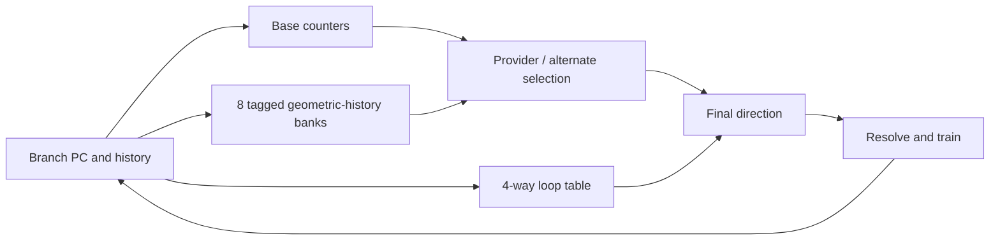

# ChampSim Architecture Lab

A working C++17 architecture lab with an **L-TAGE-style branch predictor**, loop
prediction, LRU/LFU/FIFO cache replacement, and native modules for a pinned
[ChampSim](https://github.com/ChampSim/ChampSim) revision. It includes deterministic
workloads, a reproducible configuration sweep, true simulator IPC/MPKI extraction,
and a train/validation/test workflow for externally supplied SAT solver traces.

This is a new implementation based on the project brief. The checked-in results
use **16 small synthetic workloads**. They do not establish SAT-solver gains or
performance on 13 large-scale application traces; those datasets were not supplied.

## Quick start

Requires C++17, Make, Python 3.9+ and Git. The standalone lab has no third-party
Python or C++ dependencies.

```sh
make test
make synthetic
cat results/synthetic.csv
```

Native simulator builds additionally require zlib, bzip2 and liblzma development
headers/libraries (Ubuntu: `sudo apt-get install build-essential liblzma-dev zlib1g-dev libbz2-dev`;
macOS: Xcode Command Line Tools plus `brew install xz`). The bootstrap downloads
pinned public source dependencies into ignored `.deps/`:

```sh
python3 scripts/build_champsim.py --jobs 2
python3 scripts/run_champsim.py --manifest build/synthetic/manifest.json
```

This runs nine configurations over 16 workloads (144 simulations). The default
interval is 1,000 warmup + 10,000 measured instructions. Generated traces have
20,000 instructions each. Native outputs are in `build/champsim-runs/`; functional
counts are in `results/synthetic.csv`. `results/champsim-synthetic.csv` records the
measured native sweep supplied with this repository. See
[validation](docs/VALIDATION.md) for the tested environment and exact scope.

## Implementation



- TAGE: geometric history lengths, partial tags, signed saturating counters,
  provider/alternate selection, useful-bit aging and deterministic allocation.
- Loop predictor: 64 entries, four ways, iteration-count learning, confidence and
  age, with an override only after repeated stable iterations.
- Two configurations: default histories 4–192; an experimental longer-history
  candidate spans 4–1000. Both use eight 512-entry banks and a 4096-entry base.
- Replacement: timestamp LRU, insertion-only FIFO, and LFU with LRU tie breaking;
  frequencies reset on fill. Native adapters ignore writeback hits consistently.
- Tests cover eviction ordering, invalid geometry, independent sets, predictor
  learning and determinism, malformed traces, trace hashes, metric extraction and
  tuning split validation.

The predictor updates resolved history immediately. At the pinned ChampSim
revision each branch is predicted and updated in order in `do_predict_branch`.
This adapter does not implement speculative history checkpoint/recovery for a
simulator with deferred or out-of-order predictor callbacks. The design favors
readability: history folding is recomputed, and no hardware area/timing claim is
made. It is not a bit-for-bit reproduction of Seznec's competition L-TAGE.

## Repository map

| Path | Purpose |
|---|---|
| `include/ltage.hpp` | Standalone predictor and bimodal comparison |
| `include/cache.hpp` | Replacement metadata and functional cache |
| `champsim/` | Native module-system adapters |
| `configs/` | Nine-way sweep and one-configuration smoke build |
| `scripts/` | Pin-aware build, trace generation, experiments and selection |
| `tests/` | C++ unit tests and Python harness tests |
| `results/` | Small checked-in synthetic result tables |

Read [experiments and SAT trace workflow](docs/EXPERIMENTS.md),
[provenance and licenses](docs/PROVENANCE.md), and [validation](docs/VALIDATION.md).

## License

Original code: [MIT](LICENSE). ChampSim: [Apache-2.0](docs/licenses/ChampSim-LICENSE).
Downloaded dependency source retains each upstream license. If using ChampSim in
research, cite Gober et al. as described in [provenance](docs/PROVENANCE.md).
